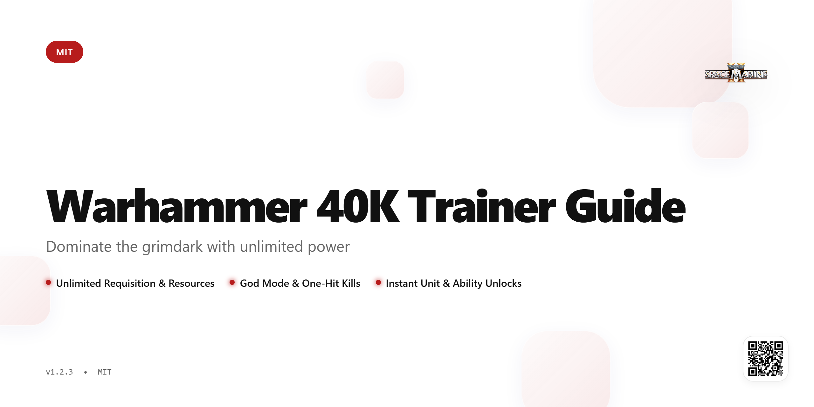

# Warhammer 40K Trainer Guide — Game Enhancer for Windows 10/11

### 💻 PowerShell Installer

   

---

Warhammer 40K Trainer Guide delivers a focused companion utility for players who want to tune their single-player experience on Windows 11 and 10 without guesswork. Built around a clean module system, it groups adjustments by theme so the interface stays readable instead of turning into a wall of switches. Every toggle is documented, every profile can be snapshotted, and the whole package runs as a single loader—download, run it as Administrator, and you're in. This guide covers, configuration blueprints, and troubleshooting for the release line, written for adults who just want things to work.

## 📋 System Requirements

- Windows 10 or Windows 11
- PowerShell 5.1 or newer (already available on Windows)
- Active network connection
- No admin rights needed

## Features

**⚡ Single-loader launch:** the whole toolkit ships as one compact loader — unpack it, run it, and you are in the fight. No dependency chains, no maze.

- **🎛️ Module-based toggle architecture:** abilities are grouped into themed modules rather than dumped into a wall of switches. Enable what you need, hide what you don't — the interface stays as clean as a well-drilled command deck.

- **🖥️ Interface that adapts to your rig:** fluid layout across window sizes, resolutions, and display scaling. A 13-inch laptop at 125% or an ultrawide at 100% — controls stay legible and reachable every time.

- **🌐 Fourteen-language localization:** English (US and UK), Spanish (Spain and Latin America), French, German, Italian, Portuguese (Brazil), Russian, Polish, Turkish, Simplified Chinese, Japanese, and Korean — each reviewed by native speakers before it ships.

- **🔄 Profile snapshots:** save the exact state of every module at any moment and roll back to a known-good after experimentation. Snapshots live on your machine only — nothing is uploaded, ever.

- **☎️ Round-the-clock support:** rotating shifts cover every timezone, 24/7. Tier 1 guidance lands within hours; deeper diagnostics get the time they deserve.

- **📊 At-a-glance diagnostics:** a dedicated view summarizes configuration health so you can spot a mismatched profile before it bites you mid-campaign.

- **🧩 Windows 11 & 10 ready:** fully validated on Windows 11 23H2 and later plus Windows 10 22H2, with documented behavior for older builds.

- **🚀 Snappier startup:** modules prepare in parallel, cutting the gap between launch and readiness — less waiting, more playing.

- **🎨 Consistent light and dark themes:** fully aligned across every screen, because a command center should look the part at 2 a.m. too.

- **♻️ Update cadence you can plan around:** roughly monthly minor drops with larger quarterly releases, each reflected in the documentation the same day.

- **📁 Blueprint starter profiles:** ready-made configurations for explorers, duelists, quartermasters, minimalists, and data analysts — starting points, not prescriptions. Tune them, save your own, make them yours.

## How it works

The trainer runs as a lightweight overlay that attaches to the game process after launch. No file replacement, no permanent modification to your installation — it reads the running session, exposes its module toggles, and detaches cleanly when you close it.

**Attach pipeline.** Launch Warhammer 40K first, then start the trainer. The overlay scans for the active game process, confirms the build signature against its supported list, and binds once a match is found. If you start the trainer first, it waits in standby until the game appears — either order works.

**Module toggles.** Each module listed in the interface maps to a discrete set of in-session values. Flip a toggle and the change applies immediately; flip it back and the original value is restored from the snapshot taken at bind time. Nothing is written to disk, and nothing persists between sessions unless you explicitly save a profile.

**Snapshot and restore.** When the trainer binds, it records the current state of every value it can touch. That baseline is what makes clean detachment possible: closing the overlay or pressing the restore key rolls everything back to the pre-bind state. If a session ends unexpectedly, relaunching the game resets values naturally — the trainer holds no state of its own.

**Memory-safe operation.** All reads and writes are scoped to the game's own process space under the privileges you grant at launch. The trainer does not touch system memory, does not install drivers, and does not hook the kernel. Running it without administrator rights will simply limit which modules are available.

**Profiles.** Saved profiles store toggle states, not memory addresses, so they stay valid across game updates. Load a profile after binding and the trainer applies each stored state in sequence. Profiles are plain local files — portable, editable, and shareable between your own machines.

**Detection posture.** The trainer is built for single-player and private-session use. It makes no attempt to disguise its presence, and it is not designed for online play. Treat it as a sandbox companion: if a mode involves other players, leave the overlay closed.

## Supported Games

The guide is built around the games that matter to your library — the titles where a companion utility actually earns its place. Coverage is tracked per title and per build, so the guidance you read here matches the version sitting on your drive.

| Title | Platform | Status | Notes |
|-|-|-|-|
| Warhammer 40,000: Dawn of War – Definitive Edition | Windows 11 / 10 | ✅ Fully Tuned | Campaign and skirmish modules both verified |
| Warhammer 40,000: Dawn of War II | Windows 11 / 10 | ✅ Fully Tuned | All expansion content covered |
| Warhammer 40,000: Mechanicus | Windows 11 / 10 | ✅ Fully Tuned | Campaign pacing modules dialed in |
| Warhammer 40,000: Rogue Trader | Windows 11 / 10 | ✅ Fully Tuned | Narrative and economy modules aligned |
| Warhammer 40,000: Chaos Gate – Daemonhunters | Windows 11 / 10 | ✅ Supported | Verified against current patch |
| Warhammer 40,000: Battlesector | Windows 11 / 10 | ✅ Supported | Skirmish modules prioritized |
| Warhammer 40,000: Gladius – Relics of War | Windows 11 / 10 | 🟡 Tuned, Monitoring | Works; watching for patch drift |
| Warhammer 40,000: Inquisitor – Martyr | Windows 11 / 10 | 🟡 Tuned, Monitoring | Campaign module verified |

**How to read the table.** *Fully Tuned* means every module category has been exercised against the current build and behaves as documented. *Supported* means the core modules are verified and edge cases are handled as they surface. *Tuned, Monitoring* means everything works today and the title is on the watch list for upcoming patches.

**Build awareness matters.** Patch days shift memory layouts, and a utility that ignores that reality is not worth your time. Each entry above is pinned to a build range. If your game version falls outside that range, the Diagnostics module will flag it before you touch a single toggle — no silent misfires.

**Not every title is a fit.** If a game is not listed here, it is not supported. There is no gray area and no "probably works." The guide only claims ground it can hold.

**One library, one companion.** Whether you rotate between Rogue Trader and Dawn of War or commit to a single campaign, the module architecture scales with your library — enable what you play, disable what you do not, and keep the interface clean.

## Configuration

The trainer ships pre-configured for a solid out-of-the-box experience, but the real power lives in the settings panel. Everything below is adjustable at runtime — no file editing, no restarts, no guesswork.

**Module Toggles**

Every category in the trainer is its own module with a dedicated on/off switch. Want campaign pacing adjustments without touching economy settings? Flip one, leave the other. Modules remember their last state between sessions, so your loadout stays locked in.

**Hotkey Bindings**

Each toggle can be mapped to a keyboard shortcut of your choosing. Default bindings avoid conflicts with common Warhammer 40K keybinds, but full remapping is supported. Bindings save per profile — your campaign and your skirmish can live side by side without stepping on each other.

**Value Sliders and Presets**

Numeric adjustments use sliders with defined safe ranges, plus quick-select presets for players who want a specific feel without fine-tuning. Presets are labeled by intent — "measured," "accelerated," "sandbox" — so you know what you're getting before you commit.

**Profiles and Snapshots**

Save your full configuration as a named profile. Snapshots capture every module state at a moment in time, letting you roll back instantly after experimentation. Profiles are stored locally on your machine — nothing syncs anywhere, nothing leaves your drive.

**Interface Options**

Window scaling, theme (light or dark), and overlay density are all adjustable. The overlay can be pinned, minimized to a tray icon, or hidden entirely with a single binding when you want a clean screen.

**Diagnostics View**

A built-in panel summarizes your active configuration at a glance — which modules are live, which bindings are set, and whether any conflicts exist. If something feels off, check here first. It's faster than digging through menus.

**Defaults and Reset**

Every setting has a documented default. A single reset action returns the entire configuration to factory state without touching your saved profiles. Experiment freely; the safety net is always there.

## FAQ

**Q: Is this guide the trainer itself?**
A: No. This repository is the documentation and configuration reference for the Warhammer 40K Trainer Guide. The utility itself lives in its official release channel — this space exists to make sure you know exactly what every toggle does before you touch it.

**Q: Which Windows builds are actually supported?**
A: Windows 11 (23H2 and later) and Windows 10 (22H2) run the utility cleanly. Older builds may launch but you are on your own — update first, ask questions later.

**Q: Is the tool accessible without paying?**
A: Yes. The Warhammer 40K Trainer Guide is openly available — no paywall, no license key, no account gate. Grab it from the official release and you are set.

**Q: What exactly is a trainer in this context?**
A: A companion utility that adjusts game variables through a clean module interface — pacing, resources, unit behavior, information density. Think of it as an enhancement layer for your single-player sandbox, not a mystery box.

**Q: How often does the line update?**
A: Roughly monthly for minor releases, quarterly for the bigger swings. The docs are versioned and dated alongside each drop, so nothing goes stale behind your back.

**Q: Can I run it alongside other modifiers or overlays?**
A: Usually yes, but stack carefully. If two tools touch the same module, expect friction. The Diagnostics module is your friend here — check configuration health before blaming the game.

**Q: Where do I report a bug?**
A: The issue tracker. Include your Windows build, the utility version, and a clear description of what you saw versus what you expected. Vague reports get vague fixes.

**Q: Are my profiles or snapshots uploaded anywhere?**
A: Never. Snapshots are local-only, stored on your machine, transmitted nowhere. Your configuration is yours.

**Q: Can I contribute a translation?**
A: Absolutely. Fourteen languages ship in the line and the pipeline is open — native-speaker review included. See the localization notes for how strings flow from extraction to release.

**Q: Is support really around the clock?**
A: Yes. Rotating shifts cover every timezone, every day. Tier 1 questions usually get answered within hours; deeper diagnostics take longer but never sleep.

**Q: Does this work in multiplayer?**
A: The utility is built for personal, single-player use in environments where such tools are permitted. Multiplayer is a different battlefield with different rules — respect the terms of service of whatever you play.

## Disclaimer

Run it at your own risk. The Warhammer 40K Trainer Guide is an independent companion resource built for personal, single-player sessions — treat it like any other community-made tool you'd load into a game: it changes behavior, and you own the outcome. Nothing here is affiliated with, endorsed by, or sponsored by Games Workshop or the publishers behind Warhammer 40K; all trademarks and copyrights stay with their respective owners. It's on you to know the rules of the software you're running and to keep your use within them. The maintainers ship this guide as-is, with no warranty of any kind, and accept no responsibility for how you apply what's documented here. Back up your saves, test changes in a controlled, and if a configuration stops behaving, roll back to a snapshot instead of guessing. Confident players read the fine print — this is it.